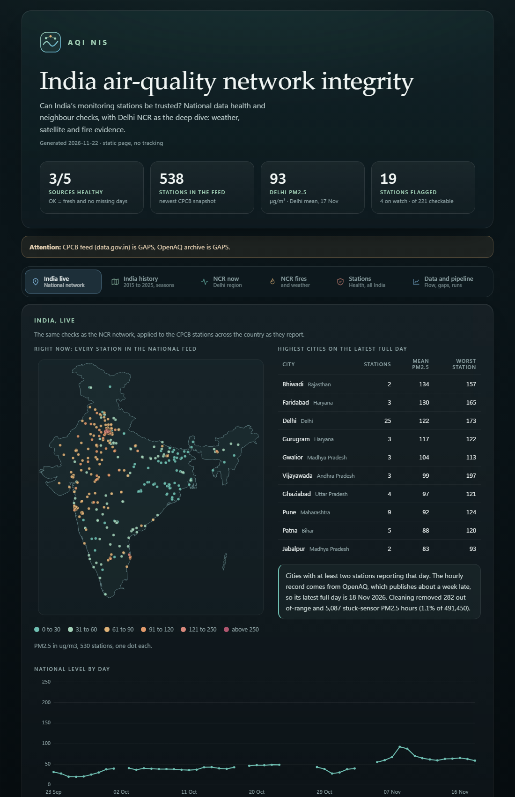
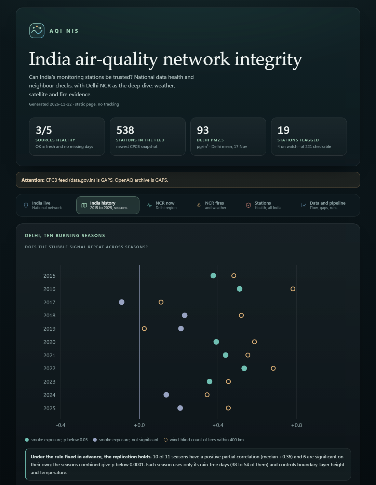

# AQI NIS: Is the Air-Quality Monitoring Network Telling the Truth?

A data-integrity audit of India's continuous air-quality monitoring network, starting from Delhi NCR. The question is simple and the answer is not: when a station reports PM2.5, can the number be trusted? Every few hours the pipeline pulls the official CPCB station feed, a second copy of the same stations from OpenAQ, NASA FIRMS fire detections, satellite aerosol optical depth and ERA5 weather, cleans and joins them on station and hour, and asks of each station whether it agrees with its neighbours, with the satellite and with itself over time. It tracks which days of data are missing and from which source, fills gaps from neighbours with an error it has measured, and tests whether the autumn pollution spikes track stubble-burning smoke arriving on the wind once rain is accounted for. A 2015 to 2025 backfill of the whole national network (about 139 million 15-minute records, 545 stations by 2025) runs the same checks over a decade. The dashboard is the way to explore all of it: every flag sits next to the caveat that limits it.

Built with Python, pandas, SciPy and xarray on public data (CPCB via data.gov.in and a yearly republication, OpenAQ, NASA FIRMS, MODIS MAIAC through Earth Engine, ERA5 from Copernicus), published as a static page on GitHub Pages and refreshed by a scheduled run on a Windows machine.

> **What it's for:** to see at a glance which sources are fresh, which stations to distrust and why, how much the gaps matter, and whether a fire-smoke story survives a rain check, instead of taking a dashboard's PM2.5 numbers on faith.

**Live dashboard:** [halcyonvector.github.io/AQI-Network-Integrity-System](https://halcyonvector.github.io/AQI-Network-Integrity-System/) (rebuilt after every scheduled data pull)





<sub>Screenshots were captured from the built page in late November 2026.</sub>

---

## Disclaimer

**This is an exploratory analysis project, not an official air-quality index, a health advisory or a fault report on any named station.** A flag means "have someone look", not "this station is broken": a station beside a road or a kiln legitimately differs from its neighbours. Every statistical result rests on weeks to a few years of data, several thresholds are judgement calls (named constants at the top of each script), and the stubble analysis shows association with fire exposure, never the share of pollution caused by burning. For health decisions use CPCB and your state pollution control board. See Honest Limitations for the specifics.

---

## Findings

What the data showed, with the dates behind each number (the live pipeline reruns these daily, so the dashboard has the latest):

- **The official feed is not in the units you would assume.** The data.gov.in CPCB feed reports AQI sub-indices (0 to 500), not concentrations: a PM2.5 value of 100 means 60 µg/m³, India's 24-hour limit. This was an assumption at first and was checked against OpenAQ's true concentrations for the same stations before any analysis relied on it (`scripts/validate_feed_units.py`).
- **The feed cannot be backfilled, and has holes.** It serves only the current snapshot. 22 days between 17 Sep and 4 Nov 2026 have no file, mostly CPCB's own outage from 26 Sep to 12 Oct. OpenAQ's archive covers the same stations in concentrations but is itself missing 24 to 26 Oct. The dashboard names each hole instead of smoothing it.
- **Station health, NCR, 21 Nov 2026:** of 61 stations with a median of 1,320 hours, 47 agree with their neighbours, 12 are flagged and 2 are on watch. Flatlines are the clearest evidence and need no statistics: 8 stations repeated one exact value for 6 or more hours (23 episodes, 251 hours in all). JNU read exactly 1.00 µg/m³ for 8 hours while its neighbours read 33.
- **A flag that was wrong, and retracted.** An early version also flagged five stations as unusually noisy. Residual noise correlated with how far a station's neighbours were (Spearman +0.44, p = 0.0004) and all five were isolated stations, predicted worse by construction. Noise is now judged against what the station's isolation predicts, and none of the five is noisy.
- **A plausible physical idea the data rejected.** Predicting a station only from upwind neighbours is worse than using all of them: on the 28,398 station-hours where the upwind rule applied, error was 0.352 against 0.308 (log units), or 42% against 36% typical error. The rule stays in the code and tests so it can be re-checked with a finer wind source.
- **Gap-filling from neighbours beats holding the last value for gaps of 6 hours or more.** Mean absolute error in µg/m³ (typical level about 110): 6 h gap 24.0 against 32.6, 12 h gap 28.0 against 41.1, 24 h gap 25.3 against 49.9. At 3 hours, holding the last value is better (25.3 against 30.1). "Same hour yesterday" is worse at every length. The filled series (`pm25_hourly_filled.csv`, 91,938 station-hours since 16 Sep) is 85.5% observed, 3.4% neighbour-filled and 10.8% still missing, and labels every value's provenance.
- **The satellite follows the city, not the station.** MODIS MAIAC AOD tracks Delhi's day-to-day PM2.5 (Spearman +0.67 over 36 days) but cannot tell stations apart on the same day, so it can only check whether a station follows its peers' day-to-day pattern. Six of 61 stations are flagged on that test (best q = 0.001), as leads for a human to look at.
- **The stubble signal was mostly rain.** Delhi's daily PM2.5 stepped from 12 to 31 µg/m³ (27 to 29 Sep) to 52 to 69 µg/m³ from 30 Sep, the day fire smoke began arriving, with a rank correlation of 0.79 against smoke exposure that survived controls for boundary-layer height and temperature. Then hourly rainfall showed 26 and 27 Sep were the wet days and 30 Sep the first dry one. On rain-free days only (n = 10 then) the correlation fell to 0.61 (p = 0.066). The real test was fixed in advance: 925 hPa exposure, lag 0, rain-free days, boundary-layer height and temperature controlled, run once, needing at least 20 rain-free days. There are now 27 such days with PM2.5, and the test has not been run.
- **The national network grew twenty-fold.** Stations reporting PM2.5: 30 in 2015, 81 in 2017, 197 in 2019, 388 in 2022, 545 in 2025. The 19.3 million clean station-hours (stuck-sensor runs remove about 0.7% in 2025; no reading fell outside the physical range) make a ten-season record, but a season before 2018 rests on 5 to 7 Delhi stations against about 35 since.
- **The stubble signal repeats across ten past seasons, but not through the wind model.** Run once under a protocol committed beforehand ([docs/STUBBLE_REPLICATION_PROTOCOL.md](docs/STUBBLE_REPLICATION_PROTOCOL.md)), on each season's 38 to 54 rain-free days with boundary-layer height and temperature controlled: 10 of 11 seasons (2015 to 2025) show a positive correlation between smoke exposure and Delhi PM2.5 (median +0.36), 6 are significant on their own, and combined across seasons the result holds (one-sided p far below 0.0001). But a plain count of fires within 400 km correlates at least as well as the wind-driven exposure in 10 of the 11 seasons, and only 2022 is significant when day-to-day autocorrelation is respected. The 2026 season's own pre-registered test is a separate run and has not been done.
- **The live national record, 23 Sep to 18 Nov 2026:** 454 CPCB stations with hourly PM2.5, of which 198 have a neighbour within 25 km and agree with it, 19 are flagged and 4 are on watch; 233 cannot be checked. Cleaning removed 282 out-of-range and 5,087 stuck-sensor hours of 491,450 (1.1%). The national median station-day mean ran from 20 to 93 µg/m³ over the 49 days with data.
- **The satellite check, nationally (23 Sep to mid Nov 2026):** 324 stations in 25 regions could be tested against MODIS AOD. In 9 regions the satellite does not track PM2.5 at all (for example a typical correlation of 0.19 around Mumbai against 0.55 around Delhi), so nothing is flagged there. Across the rest, 4 stations are flagged and 16 are on watch after a correction that runs over every tested station in the country.
- **National audit, 2025:** 543 stations reported, but only 240 have a neighbour within 25 km and could be checked at all; 117 of those carry a flag, though the share of hours flagged is at most 2.7% in any of the 30 cities with at least three auditable stations. Counted in days instead of hours (a day fails when at least 6 of its hours are inside a stuck run or a sustained departure), the picture is the same: 0.5% of station-days in 2025 against 0.4% of station-hours, and at most 1.9% of days in any of those cities. Three stations show confirmed drift against their neighbours across the eleven years (Punjabi Bagh in Delhi in 2017, RVCE-Mailasandra in Bengaluru in 2022, Vijay Nagar Scheme-78 in Indore in 2025).
- **Delhi's October-November mean PM2.5 ranged from 142 µg/m³ (2022) to 210 µg/m³ (2016)** across the ten seasons, while regional fire detections (Suomi NPP) fell from 102,980 in 2021 to 14,864 in 2025. These are descriptive, with no rain or wind control.
- **Weather history is blocked.** Repeating the stubble test on past seasons needs ERA5 winds and rain from the Copernicus Data Store, which rejected every request this project made in November 2026 with "maximum number queued requests reached", during the period of ECMWF's service protection measures (announced 22 Oct 2026). The cause for this account is not confirmed. The public ERA5 mirror is laid out as one whole-globe hour per file, which would mean hundreds of GB for the winds alone, and the Open-Meteo history API has no 925 hPa winds.

---

## Features

### Dashboard

- **Six tabs, no JavaScript, India first:** India live (every station in the national feed on a map, the national daily level, the highest cities, neighbour-check health), India history (the 2015 to 2025 audit and the ten Delhi burning seasons), Stations (neighbour-consistency health for every station in India by state, a regional satellite check, then the Delhi NCR detail), then the Delhi NCR deep dive: NCR now (by city, map and ranking), NCR fires (Delhi PM2.5 against regional fire exposure and the weather controls) and Data and pipeline (source freshness, completeness, every station by day, recent runs, what is next). A hidden radio input per tab selects its panel.
- **Findings next to their caveats.** Each chart carries a note saying what it does not show, and a result the analysis has not produced is shown as "not run yet" instead of being omitted.
- **One static HTML file with inline SVG,** rebuilt after every data pull and deployed by a GitHub Actions workflow.

### Source health

- Per-source tracker of the last 30 days (file present, missing, not yet expected), with each source's normal publication lag, so "6 days old" is correct for ERA5 and an alarm for FIRMS.
- Status labels OK, GAPS, STALE and DOWN, and a log of scheduled runs flagging failed steps and interrupted runs, including a push that did not reach GitHub.

### Station checks

- **Neighbour consistency:** each station's hourly PM2.5 is predicted leave-one-out from up to six neighbours within 25 km, in log space with a per-site offset. Residuals are tested for stuck sensors, sustained departures, unusual noise (adjusted for isolation) and slow drift (Kendall trend, Benjamini-Hochberg correction, effect-size floors).
- **Satellite consistency:** a station is compared with the satellite's day-to-day pattern against the network's median, and only flagged if it survives multiple-testing correction.
- **Gap-filling:** neighbour prediction with a measured error, falling back to labelled gaps when no neighbour reports.

### Stubble transport analysis

- A screening-level forward-trajectory model: each VIIRS fire detection releases a parcel advected up to 72 hours on 925 hPa ERA5 winds, and a hit is a parcel passing within 60 km of Delhi. The daily exposure index is the radiative-power-weighted hits per day, with fires already within 60 km excluded as local.
- Permutation and circular-shift tests (which respect autocorrelation), partial correlation on boundary-layer height and temperature, and a rain-free restriction fixed before the data arrived.

### 2015 to 2025 backfill

- **Bronze to gold in `historical/`:** yearly CPCB station files, a station master table with stable IDs, a cleaned station-hour layer reusing the live QC rules, exports of daily fire counts, Delhi daily PM2.5 and completeness by state and month, and the national audit with a city league and drift watchlist.
- **Repairs itself:** a step in every daily run finds days missing between a source's first and newest file and re-requests exactly those, so a laptop that was off for a week heals on the next run.

### Automation

- A Windows scheduled task at 12:00 and 19:00 fetches, analyses, commits and pushes in two stages, so a slow weather request can never block publishing the fast data.

---

## Data Source

| Source | Type | API Key? | What It Provides |
|--------|------|----------|-------------------|
| [CPCB real-time AQI via data.gov.in](https://www.data.gov.in/catalog/real-time-air-quality-index-various-locations) | REST (JSON) | Yes | Current AQI sub-indices for every station in India (the live feed; PM2.5 and PM10 are kept nationally, all pollutants for NCR). Only the current snapshot, no history. Rejects cloud IP addresses |
| [CPCB yearly station files (Vonter/india-cpcb-aqi)](https://github.com/Vonter/india-cpcb-aqi) | Parquet releases | No | 15-minute concentrations and station meteorology for 2009 to 2025, republished from CPCB's data repository. ODbL 1.0 |
| [OpenAQ](https://docs.openaq.org) | S3 archive and REST | Yes | Hourly concentrations from the same stations, used to validate units, to cover feed gaps, and as the live national hourly record (about 500 stations, published roughly a week late) |
| [NASA FIRMS](https://firms.modaps.eosdis.nasa.gov) | REST (CSV) | Yes | VIIRS active-fire detections: live (near-real-time) and the 2015 to 2025 standard-processing archive |
| [MODIS MAIAC AOD](https://developers.google.com/earth-engine/datasets/catalog/MODIS_061_MCD19A2_GRANULES) | Google Earth Engine | Yes (Cloud project) | Aerosol optical depth sampled at each station |
| [ERA5, Copernicus Data Store](https://cds.climate.copernicus.eu/datasets/reanalysis-era5-single-levels) | NetCDF through `cdsapi` | Yes | 10 m and 925 hPa winds, boundary-layer height, temperature and rain |

---

## Tech Stack

| Layer | Technology | Details |
|-------|-----------|---------|
| **Language** | Python 3.11+ | Developed on 3.14 |
| **Data handling** | pandas, NumPy, xarray, netCDF4, PyArrow | CSV per source and date, Parquet for the national backfill |
| **Statistics** | SciPy | Spearman, Kendall, Theil-Sen, permutation and circular-shift tests, Benjamini-Hochberg |
| **Fetching** | requests, cdsapi, earthengine-api, GitHub CLI | Trailing-window, self-healing fetchers; per-date overwrite files |
| **Dashboard** | Hand-built HTML and inline SVG | No JavaScript, no external assets, HTML-escaped data |
| **Testing** | pytest | Unit tests on synthetic and real-shaped data |
| **Hosting** | GitHub Pages and GitHub Actions | `pages.yml` deploys `dashboard/` on every push that touches it |
| **Scheduling** | Windows Task Scheduler | `scripts/run_and_push.ps1` at 12:00 and 19:00 from a residential connection |

---

## Prerequisites

- **Python 3.11+**
- **A residential internet connection** for the data.gov.in feed, which refuses cloud and datacentre addresses
- **API keys and accounts:** a CPCB key from data.gov.in, a NASA FIRMS map key, an OpenAQ key, a Google Earth Engine Cloud project, and a Copernicus CDS account with the ERA5 terms accepted. Setup for each is in [docs/PIPELINE.md](docs/PIPELINE.md)
- **GitHub CLI (`gh`)** only for the 2015 to 2025 backfill download

---

## Quick Start

```bash
pip install -r requirements.txt
cp .env.example .env      # then fill in the keys
```

Run the pipeline once, in the order the scheduled run uses:

```bash
python scripts/fetch_cpcb.py
python scripts/fetch_openaq.py
python scripts/fetch_firms.py
python scripts/fetch_aod.py
python scripts/backfill_missing.py
python scripts/convert_feed.py
python scripts/analyze_neighbor_consistency.py
python scripts/build_filled_series.py
python scripts/analyze_station_bias.py
python scripts/analyze_stubble_transport.py
python scripts/build_dashboard.py
```

Open `dashboard/index.html` in a browser. The ERA5 fetch (`scripts/fetch_era5_wind.py`) queues on Copernicus for hours, so the scheduled run puts it last.

### The 2015 to 2025 backfill

```bash
python historical/fetch_cpcb_history.py     # 11 yearly files, about 3.9 GB
python historical/fetch_firms_history.py    # fire archive, minutes
python historical/build_station_table.py    # station master with stable IDs
python historical/build_silver.py           # clean hourly PM2.5 and PM10
python historical/build_gold.py             # fire, Delhi and completeness tables
python historical/national_audit.py         # neighbour and drift audit, city league
```

The large Parquet and weather files live in `data/historical/`, which git ignores. Only the small summaries in `data/processed/historical/` are committed.

### Scheduling (Windows)

```bash
powershell -NoProfile -ExecutionPolicy Bypass -File scripts/run_and_push.ps1
```

Point Task Scheduler at that command for 12:00 and 19:00, with a 6 hour execution limit. The script commits and pushes the fast data first and the weather-dependent results second.

### Tests

```bash
python -m pytest -q
```

---

## Project Structure

```
AQI NIS/
├── README.md
├── requirements.txt, requirements-dev.txt, .env.example
├── .github/workflows/pages.yml        # Deploys dashboard/ to GitHub Pages
├── dashboard/index.html               # The built page (generated, committed)
├── docs/
│   ├── PIPELINE.md                    # Per-source setup and the long analysis write-ups
│   └── screenshots/                   # README images
│
├── scripts/
│   ├── fetch_cpcb.py (national and NCR files), fetch_openaq.py, fetch_openaq_india.py, analyze_national_live.py, fetch_firms.py, fetch_aod.py, fetch_era5_wind.py
│   ├── backfill_missing.py            # Re-requests days missing between a source's first and newest file
│   ├── convert_feed.py, aqi_units.py  # Feed AQI sub-indices to concentrations
│   ├── qc.py                          # Range and stuck-sensor checks shared by live and history
│   ├── analyze_neighbor_consistency.py, analyze_station_bias.py, analyze_stubble_transport.py
│   ├── build_filled_series.py         # Gap-filled hourly PM2.5 with provenance
│   ├── windfield.py, datewin.py       # Wind interpolation and trailing-window helpers
│   ├── build_dashboard.py, dashboard_extras.py, dashboard_historical.py
│   └── run_and_push.ps1               # The scheduled driver
│
├── historical/                        # The 2015 to 2025 backfill
│   ├── fetch_cpcb_history.py, fetch_firms_history.py, fetch_era5_history.py
│   ├── station_master.py, build_station_table.py
│   ├── build_silver.py, build_gold.py
│   └── national_audit.py
│
├── data/
│   ├── raw/                           # One file per source and date (committed)
│   ├── processed/                     # Analysis outputs (committed)
│   │   └── historical/                # Small national summaries (committed)
│   ├── reference/                     # Station mapping
│   └── historical/                    # Large Parquet and weather files (git-ignored)
│
└── tests/                             # pytest suites for every module above
```

---

## Architecture

```
  CPCB feed (data.gov.in)   OpenAQ archive   NASA FIRMS   MODIS AOD (Earth Engine)   ERA5 (Copernicus)
          │                      │               │                  │                       │
          └──────────┬───────────┴───────┬───────┴─────────┬────────┘                       │
                     ▼                   ▼                 ▼                                │
              data/raw/<source>_<date>.csv   (trailing window, overwritten per date)        │
                     │                                                                      │
        backfill_missing.py fills any day missing inside a source's range                   │
                     ▼                                                                      │
   convert_feed ► analyze_neighbor_consistency ► build_filled_series ► analyze_station_bias │
                     ▼                                                                      │
        analyze_stubble_transport ◄──────────────────────────────────────── winds, rain ◄──┘
                     ▼
              build_dashboard.py ──► dashboard/index.html ──► git push ──► GitHub Pages
```

How a result gets built:

1. **Fetch:** each source re-processes a short trailing window, so a missed run heals itself. Each date is its own overwritten file.
2. **Heal:** `backfill_missing.py` fills days missing between a source's first and newest file. The CPCB feed cannot be healed, because it never serves history.
3. **Convert and clean:** feed sub-indices become concentrations; range and stuck-sensor checks remove implausible hours.
4. **Check:** neighbour consistency, satellite consistency and the gap-fill backtest run on the cleaned hourly series.
5. **Attribute:** fire detections are advected on ERA5 winds and compared with Delhi PM2.5 under the pre-registered protocol.
6. **Publish:** the dashboard is rebuilt, committed and pushed in two stages, so slow weather requests never block the fast data. A push that is rejected is rebased and retried, and a failure is logged.

The national backfill reuses the same QC and neighbour-consistency code. The only step it skips is the wind-conditioned predictor, which the live data showed does not help.

---

## Testing

```bash
python -m pytest -q
```

**Pipeline and analysis:** fetch-window and self-healing logic, the unit conversion round trip, the stuck-sensor rule (including a test that one stuck neighbour corrupts a mean but not a median), the leave-one-out predictor, the drift trend test and the multiple-testing correction, the isolation-adjusted noise rule that retracted five false flags, the gap-fill backtest against its baselines, and the stubble protocol's rain-free restriction, circular-shift test and valid-day window.

**Dashboard:** every panel renders from missing and malformed inputs, all data-derived text is HTML-escaped, the page contains no script and no external address except the footer's source and project links, the tab bar selects panels without JavaScript and leaves out empty tabs, and each footer link opens in a new tab.

**Backfill:** the station matching rules (coordinates, then name, one match per source), the 15-minute to hourly conversion including the IST offset, the range and flatline cleaning, the audit on a synthetic network with a stuck station and an isolated one, and the request planning for ERA5 and FIRMS.

The dashboard's appearance is checked by building the page and viewing it in a browser rather than by unit tests.

---

## Honest Limitations

- **The national satellite check is regional and short.** Peers are stations within about 150 km, many regions have only a handful of testable stations, and monsoon and cloud cut the usable days, so it is a screening tool. The NCR version has the same limits with more days behind it.
- **The live national record is one source and a week late.** It rests on OpenAQ alone (no second feed to cross-check against), about 233 of 454 stations have no neighbour within 25 km and cannot be checked, and its latest full day trails the present by about a week. The NCR analyses are deeper: two sources, weather, satellite and fire evidence.
- **Short live record.** The NCR analyses rest on about nine weeks of data (16 Sep onward). Thresholds are judgement calls, kept as named constants, and every flag is a lead.
- **The stubble test has not been run.** It is pre-registered to run once, and sequential testing would inflate false positives. Until it is, nothing here says how much of Delhi's PM2.5 comes from burning, and the screening model cannot give a magnitude in any case: it has no vertical mixing, deposition or plume rise and uses a single receptor.
- **The replication is about association, not cause.** The trajectory model adds nothing over a wind-blind fire count, the first two seasons rest on 6 Delhi stations, and the exposure index measures smoke arrival, not mass.
- **Most stations cannot be audited.** The neighbour test needs another station within 25 km, which about half of the national network lacks, so a clean league table is not the same as clean data.
- **"Flagged" is a low bar.** A flag needs one stuck-sensor run or one sustained departure. Hours flagged (a few percent at most) is the better measure of how much of a station's record is affected.
- **Thin early years.** 2015 to 2017 have 30 to 81 stations nationally and 5 to 7 in Delhi, so a season then is not comparable with one from 2020.
- **No station coordinates in the yearly CPCB files.** Coordinates come from OpenAQ by exact station name; 56 of 559 historical stations did not match and cannot be placed on the map. 30 stations in the live feed have no history at all (recent or renamed).
- **The India map has no outline.** It plots stations on a latitude and longitude grid; a simplified boundary would need a file this project does not yet carry.
- **A drift has no start date.** The audit fits a straight line over a year, so it reports the year and the size of the shift, not when it began, and cannot tell a re-siting or recalibration from a failing sensor.
- **OpenAQ and the feed disagree in places.** OpenAQ's archive is missing days the feed has and the other way round; the filled series prefers observed values and labels the rest.
- **ERA5T is preliminary** for the newest days, and precipitation is an area mean over a box of about 130 km, so local showers are smoothed.
- **One sensor for fires across all seasons.** The replication would use Suomi NPP alone for consistency, and the large fall in detections from 2021 to 2025 is a real change the test has to survive, not something it can adjust for.
- **The live feed needs a residential connection** and a machine that is on. Days missed from the feed itself are unrecoverable, although OpenAQ and the yearly files cover most of them for PM2.5.
- **Tabs cannot be linked to.** Switching panels without JavaScript means the page always opens on Overview.

---

## Suggested Future Features

- Run the 2026 season's own pre-registered stubble test once the dry-day target is confirmed, and compare it with the ten past seasons.
- Draw an India outline under the integrity map, and place the stations that did not match by name.
- Add a 24 to 72 hour PM2.5 forecast against a persistence baseline, only if it can be scored honestly.
- Alert on a station newly stuck, not just list it.
- Bring the weather, satellite and fire analyses to other regions, starting with the Indo-Gangetic plain.

---

## Author

**Sagnik**

GitHub: [@HalcyonVector](https://github.com/HalcyonVector)

---

## License

The code is released under the [MIT License](LICENSE).

The data keeps the terms of its sources, which the MIT licence does not change. The 15-minute CPCB station files come from Vonter/india-cpcb-aqi under the Open Database License (ODbL 1.0), so tables derived from them in this repository carry that licence's attribution and share-alike terms. OpenAQ, NASA FIRMS and MODIS, ERA5 from Copernicus, and data.gov.in each have their own terms of use; check them before reusing a derived table.
